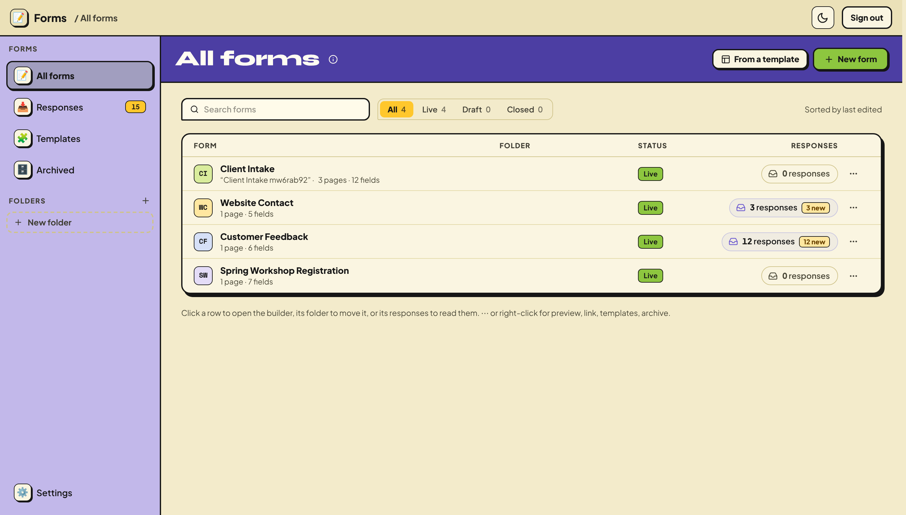

# GRYD Forms

**[▶ Try the live demo](https://gryd-forms-demo.fly.dev)** (no sign-up) · [Open in Codespaces](https://codespaces.new/josh-gryd/gryd-forms) · [Deploy your own](#put-it-online-for-real)

Self-hosted forms you own. A builder, public form links, branching logic, file uploads, and an inbox for responses, all in one small app with a SQLite file for storage.



We used to pay $120 a month for Typeform and then $80 a month for Fillout. Neither did everything we needed, for example refusing free email addresses (gmail, yahoo…) on a "work email" question. So we built this, ran it for two months, and cancelled Fillout. Now it's yours too, under the MIT license.

## What it does

- **Builder.** Type to add questions, a `/` menu, drag-and-drop columns, undo, and autosave with conflict handling. More than 25 field types: text, email, phone, number, choice, checkboxes, dropdown, date and time, rating, scale, ranking, matrix, address, signature, file upload, hidden fields, and more.
- **Logic.** Show, hide and skip pages on any answer. Several endings, a redirect ending, and answers piped into later questions (`{{answer:…}}`).
- **Publishing.** Draft and live versions are separate, so editing never breaks the live link until you publish. You can schedule open and close times, cap the number of responses, password-protect a form, and block duplicates by device or email.
- **Work emails only.** Turn it on for an email question and free addresses are refused.
- **Responses.** An inbox across every form with unread counts, search over answers, a per-form summary (charts, completion rate, median time) and CSV export. Respondents can edit their answers through their own link.
- **Look.** Themes, fonts, a logo and a background image. Respondent text comes in 7 languages. There's an embed snippet and a QR code.
- **Notifications.** Email to you, a confirmation to the respondent, and posts to a Slack channel. All optional.
- **Spam.** A honeypot, timing and user-agent signals, and per-IP rate limits.
- **Phone.** The public form and the portal both work at phone width.

## Try the live demo

**[gryd-forms-demo.fly.dev](https://gryd-forms-demo.fly.dev)**: build a form, publish it, answer it, read the responses. No sign-up. It's shared with everyone and resets every hour, so don't enter anything real.

## Try it in your browser (no install)

GitHub Codespaces runs the app on a computer in the cloud, from your browser. You need a free GitHub account.

1. Click **[Open in GitHub Codespaces](https://codespaces.new/josh-gryd/gryd-forms)** and sign in to GitHub if asked.
2. On the "Create codespace" page, keep the defaults and click **Create codespace**. If GitHub asks whether you trust the repository, confirm.
3. Wait about 2–3 minutes. An editor opens, installs everything and starts the app.
4. A new tab opens on the app. **If it doesn't** (browsers often block it): click the **Ports** tab at the bottom of the editor, find **Forms (open this one)** on port 3000, and click the globe icon next to it.
5. Click **New form** or **From a template**, publish, and open the link from **Share**.

Good to know:
- **The link is private to you.** Anyone else opening it hits a GitHub sign-in. To let someone else answer a form, right-click the port in **Ports** → **Port Visibility** → **Public**, or deploy your own copy (below).
- **It's free within GitHub's monthly allowance** (about 60 hours a month on the default machine for personal accounts; see [GitHub's Codespaces billing](https://docs.github.com/en/billing/managing-billing-for-your-products/managing-billing-for-github-codespaces/about-billing-for-github-codespaces)).
- **Stopping vs deleting.** A codespace stops on its own after 30 idle minutes and keeps your forms; stopped ones only use a little storage. When you're done, delete it at [github.com/codespaces](https://github.com/codespaces) (⋯ → Delete). That also deletes the forms in it.
- The portal has no password in a codespace. Add one by stopping the app in the terminal (Ctrl+C) and running `FORMS_ADMIN_PASSWORD=pick-one npm run dev`.

## Run it on your own computer

You need [Node.js](https://nodejs.org) 20.9 or newer.

```bash
git clone https://github.com/josh-gryd/gryd-forms.git
cd gryd-forms
npm install
npm run dev
```

Open http://localhost:3000. With no password set, the portal is open on your machine.

## Put it online for real

A real install needs a server that stays on, a disk that keeps your data, and HTTPS. Production also needs one setting: **`FORMS_ADMIN_PASSWORD`**, the password for the portal. Without it, nobody can sign in.

### The recommended way: Fly.io (about $2–5 a month)

You can do all of this from the terminal inside your codespace, so there's nothing to install on your computer.

1. Create an account at [fly.io](https://fly.io/app/sign-up). Fly asks for a card.
2. Install Fly's command-line tool and sign in:
   ```bash
   curl -L https://fly.io/install.sh | sh && export PATH="$HOME/.fly/bin:$PATH"
   fly auth login
   ```
3. Pick a name for your app (it becomes `https://<name>.fly.dev`), then create it with a disk for your data:
   ```bash
   fly apps create <name>
   fly volumes create forms_data --size 1 --region iad -a <name> --yes
   ```
   `iad` is Virginia. For [another region](https://fly.io/docs/reference/regions/), use it here and change `primary_region` in `fly.toml` to match.
4. Set your password and address:
   ```bash
   fly secrets set -a <name> FORMS_ADMIN_PASSWORD='pick-a-long-one' FORMS_PUBLIC_URL=https://<name>.fly.dev
   ```
5. Deploy:
   ```bash
   fly deploy -a <name> --ha=false
   ```
   The first deploy takes 3–5 minutes. Then open `https://<name>.fly.dev` and sign in with your password.

To update later, pull the newest code and run `fly deploy -a <name>` again. Your forms and responses stay on the disk.

### Other ways

**Docker** on any server with a disk:

```bash
docker build -t gryd-forms .
docker run -p 3000:3000 -v forms-data:/data \
  -e FORMS_ADMIN_PASSWORD=change-me -e FORMS_PUBLIC_URL=https://forms.example.com \
  gryd-forms
```

It also runs on Railway, Render, or a VPS with Node and a disk. Put it behind HTTPS.

## Settings

Every setting is in [`.env.example`](.env.example). The main ones:

| Setting | What it does |
|---|---|
| `FORMS_ADMIN_PASSWORD` | Portal password. Required in production. |
| `FORMS_PUBLIC_URL` | Your app's address, used in email and Slack links. |
| `FORMS_ADMIN_EMAIL` | Your email, used as the owner of new forms and the default alert recipient. |
| `FORMS_DATA_DIR` | Where the database and uploads live (default `./data`). |
| `FORMS_SMTP_URL`, `FORMS_EMAIL_FROM` | Turn on email. Any SMTP provider works. With [Resend](https://resend.com): `FORMS_SMTP_URL=smtps://resend:<api key>@smtp.resend.com:465` and `FORMS_EMAIL_FROM=Forms <forms@yourdomain.com>`. With Gmail, use an [app password](https://support.google.com/accounts/answer/185833): `smtps://you%40gmail.com:<app password>@smtp.gmail.com:465`. |
| `SLACK_BOT_TOKEN` | Turn on Slack posts. Create a Slack app with `chat:write`, `channels:read`, `groups:read`, `users:read` and `users:read.email`, install it, and invite it to the channel. |
| `FORMS_DEMO=1` | Public demo mode: no sign-in, wiped and re-seeded every hour, uploads, redirect endings, email and Slack off, per-visitor limits, never indexed. See `engine/demo.ts`. |
| `FORMS_DEV_ORIGINS` | Dev only: extra hostnames allowed to open the dev server (Codespaces and Gitpod already are). |
| `FORMS_PUBLIC_HOST` | Serve forms at the root of a second domain (`forms.example.com/<slug>`). |
| `BUCKET_NAME` + `AWS_*` | Store uploads in S3, R2 or Tigris instead of the data folder. |

Back up the data folder and you have everything: `forms.db` and `files/`.

## How it's built

One Node process (`server.ts`) runs two things:

```
browser ──► Next.js app (PORT)               portal pages, public form /f/<slug>, /api proxies, sign-in
                │  lib/engine-fetch.ts (127.0.0.1 + a secret made at boot)
                ▼
            forms engine (Express, 127.0.0.1 only)   engine/forms: validation, logic, storage, notifications
                │
                ▼
            SQLite (better-sqlite3)  +  files on disk or S3
```

- `engine/forms/core/` is shared by the server and the browser: the form schema, the field registry, logic, validation, the respondent copy in 7 languages, and templates. The browser imports it as `@/lib/forms-core`.
- `engine/forms/` holds the service, the repository (SQL), the HTTP routes, storage, notifications and the spam signals.
- `app/forms/` is the portal: the builder (`builder/`), responses, templates, settings and the shared form renderer (`render/`).
- `app/f/[slug]/` is the public form.
- `proxy.ts` is the sign-in gate. Public forms and their API stay open; everything else needs the session cookie.

## Make it yours

The codebase is set up to be changed with an AI coding assistant. [`CLAUDE.md`](CLAUDE.md) explains where things live and how to add a field type. Some good first changes:

- Add a field type: one file in `engine/forms/core/components/`, plus its renderer in `app/forms/render/registry.tsx`.
- Change the default theme: `engine/forms/core/theme.ts`.
- Add a template: `engine/forms/core/templates.ts`.
- Send responses somewhere else (a CRM or a webhook): `engine/forms/notify.ts` runs after every response.

## Tests

```bash
npm test             # unit tests (engine + UI logic)
npm run typecheck
npm run build && FORMS_ADMIN_PASSWORD=e2e-pass npm start   # then, in another terminal:
FORMS_ADMIN_PASSWORD=e2e-pass npm run test:e2e             # browser tests (Playwright)
```

## License

MIT. See [LICENSE](LICENSE).
